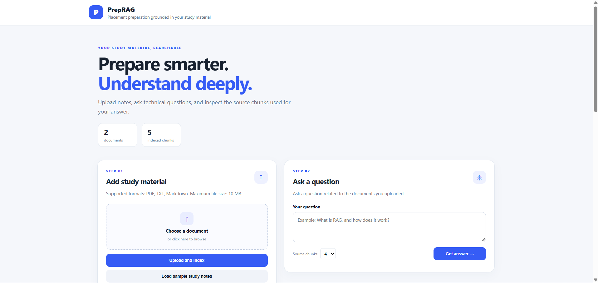
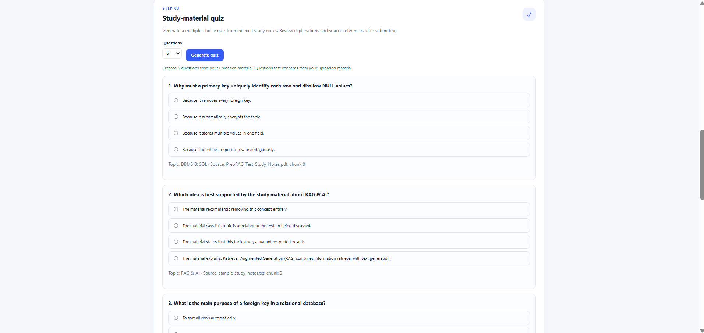
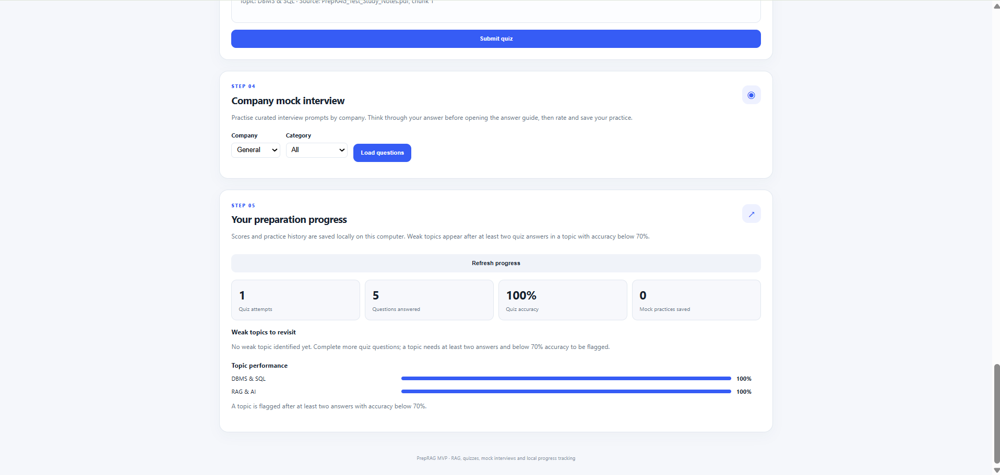
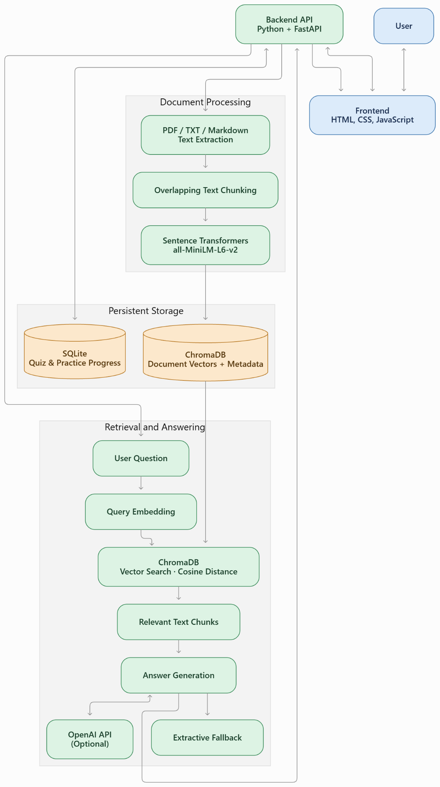
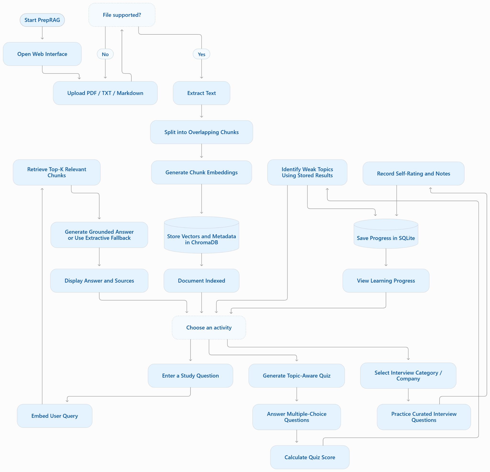

<div align="center">

# PrepRAG — AI Placement Preparation Hub

**Prepare smarter. Understand deeply.**

A document-grounded placement preparation web app that lets students upload study notes, ask questions, review source chunks, practise quizzes and mock interviews, and track preparation progress locally.

</div>

---

## ✨ Features

### 📚 Study Material and RAG
- Upload PDF, TXT, and Markdown study materials.
- Extract text and split it into overlapping chunks.
- Generate document and query embeddings with Sentence Transformers (`all-MiniLM-L6-v2`).
- Store document chunks, vectors, and metadata in persistent ChromaDB storage.
- Retrieve semantically relevant chunks for a user's question.
- Display source filenames, chunk references, excerpts, and retrieval distances.
- Use optional OpenAI-powered answer generation, with a local extractive fallback when no API key is configured.
- Load sample notes to explore the workflow without preparing a document first.

### 🧠 Study-Material Quiz
- Generate multiple-choice practice questions from indexed material.
- Review answers, explanations, and source references.
- Calculate and display quiz results.
- The offline quiz generator uses a predefined template bank matched to recognized concepts; it is not a general-purpose LLM quiz writer.

### 🎯 Company Mock Interview Practice
- Browse curated practice prompts by company/category.
- Review an answer guide after attempting a question.
- Rate practice attempts and save optional notes.
- Questions are practice material and are not claimed to be official company interview questions.

### 📈 Preparation Progress
- Track quiz attempts, answered questions, and topic performance.
- Flag topics for revision using a lightweight heuristic: at least two answers for a topic and accuracy below 70%.
- Save mock-practice ratings and notes locally using SQLite.

---

## 🖥️ Screenshots

### Main Dashboard



### Study-Material Quiz



### Preparation Progress



---

## 🏗️ System Architecture

The backend is built with FastAPI. Uploaded documents are parsed and chunked, then embedded with Sentence Transformers and stored in ChromaDB. For a question, the same embedding model encodes the query, ChromaDB retrieves relevant chunks, and the application uses either the configured OpenAI API or a local extractive fallback to prepare the response.



---

## 🔄 Application Workflow

1. Start PrepRAG and open the browser interface.
2. Upload a PDF, TXT, or Markdown document, or load the sample notes.
3. Extract text and split it into overlapping chunks.
4. Generate embeddings and store vectors and metadata in ChromaDB.
5. Ask a question about the indexed material.
6. Embed the question and retrieve relevant chunks.
7. Generate an answer using the optional OpenAI API or the extractive fallback.
8. Review the answer and source references, or use the quiz, mock interview, and progress tools.



---

## 🛠️ Tech Stack

| Area | Technologies |
|---|---|
| Backend | Python, FastAPI, Uvicorn |
| Frontend | HTML5, CSS3, JavaScript |
| Embeddings | Sentence Transformers — `all-MiniLM-L6-v2` |
| Vector database | ChromaDB |
| Local progress database | SQLite |
| Document processing | pypdf, Python text processing |
| Optional answer generation | OpenAI API |
| Testing | pytest |

---

## 📂 Project Structure

```text
PrepRAG/
├── app/
│   ├── main.py                 # FastAPI application and routes
│   ├── documents.py            # Text extraction and overlapping chunking
│   ├── vector_store.py         # Embeddings and ChromaDB operations
│   ├── answering.py            # Optional LLM and extractive fallback
│   ├── study_features.py       # Quiz, mock interview, and progress features
│   ├── schemas.py              # Request/response models
│   ├── config.py               # Configuration
│   └── static/
│       ├── index.html
│       ├── styles.css
│       └── app.js
├── assets/
│   ├── architecture.png
│   ├── workflow.png
│   └── screenshots/
│       ├── dashboard.png
│       ├── quiz.png
│       └── progress.png
├── tests/
│   └── test_documents.py
├── .env.example
├── .gitignore
├── requirements.txt
├── requirements-dev.txt
├── run_windows.bat
├── run_mac_linux.sh
├── PROJECT_NOTES.md
└── README.md
```

---

## ⚙️ Installation and Setup

### Prerequisites
- Python 3.10 or 3.11 recommended.
- Git.
- Internet access for package installation and the first embedding-model download.
- An OpenAI API key only if you want to enable OpenAI-powered answers.

### 1. Clone the repository

Replace `<your-username>` with your GitHub username after creating the repository.

```bash
git clone https://github.com/<your-username>/PrepRAG.git
cd PrepRAG
```

### 2. Create and activate a virtual environment

**Windows (PowerShell):**

```powershell
py -3 -m venv .venv
.venv\Scripts\Activate.ps1
```

If PowerShell blocks activation, use Command Prompt:

```bat
.venv\Scripts\activate.bat
```

**macOS / Linux:**

```bash
python3 -m venv .venv
source .venv/bin/activate
```

### 3. Install dependencies

```bash
python -m pip install --upgrade pip
pip install -r requirements.txt
```

### 4. Configure environment variables

Copy the example file:

**Windows:**
```powershell
copy .env.example .env
```

**macOS / Linux:**
```bash
cp .env.example .env
```

The app can run without an OpenAI API key using the local extractive fallback. To enable OpenAI-powered answer generation, add your own key to `.env` and configure the model as described in `.env.example`.

> **Security:** Never commit `.env`, API keys, tokens, or private credentials to GitHub.

### 5. Run the application

```bash
python -m uvicorn app.main:app --reload
```

Open the application at:

- Web interface: `http://127.0.0.1:8000`
- Interactive API docs: `http://127.0.0.1:8000/docs`

The first use of Sentence Transformers may download the embedding model, so startup or first indexing may take longer.

---

## 🧪 Quick Demo

1. Open the web interface.
2. Click **Load sample study notes**.
3. Ask a question such as `What is RAG and how does it work?`
4. Inspect the answer and the retrieved source chunks.
5. Generate a quiz from indexed material.
6. Try the company mock interview section.
7. Open the preparation progress section to review local quiz and practice history.

---

## 🔌 API Endpoints

| Method | Endpoint | Purpose |
|---|---|---|
| `GET` | `/api/health` | Check service health |
| `GET` | `/api/stats` | Get document and chunk counts |
| `GET` | `/api/documents` | List indexed documents |
| `GET` | `/api/sample-study-notes` | Get built-in sample notes |
| `POST` | `/api/upload` | Upload and index a PDF, TXT, or Markdown file |
| `POST` | `/api/ask` | Ask a question about indexed material |
| `POST` | `/api/quiz/generate?count=5` | Generate a quiz |
| `POST` | `/api/quiz/submit` | Submit answers and receive score/review |
| `GET` | `/api/mock/questions` | Retrieve mock interview practice questions |
| `POST` | `/api/mock/attempt` | Save a self-rated practice attempt |
| `GET` | `/api/progress` | Retrieve local progress and weak-topic summary |

See `http://127.0.0.1:8000/docs` for interactive API documentation and request schemas.

---

## 🧩 How the RAG Pipeline Works

1. **Text extraction:** Read text from supported PDF, TXT, and Markdown files.
2. **Chunking:** Split extracted text into overlapping text chunks to preserve context across boundaries.
3. **Embedding generation:** Encode each chunk using `all-MiniLM-L6-v2`.
4. **Vector storage:** Store embeddings and associated text/metadata in persistent ChromaDB storage.
5. **Query embedding:** Encode the user's question with the same embedding model.
6. **Semantic retrieval:** Search ChromaDB using cosine distance to find relevant chunks.
7. **Answering:** Use retrieved context with the optional OpenAI API, or select relevant sentences through the local extractive fallback.
8. **Source display:** Show source references and excerpts so users can inspect the retrieved evidence.

**Important:** Cosine distance is a retrieval-distance measure, not an answer-confidence percentage. A smaller distance indicates closer vectors for the configured collection. The relevance threshold is a configurable starting heuristic and should be evaluated against representative questions.

---

## 🧪 Tests

Install development dependencies and run the available tests:

```bash
pip install -r requirements-dev.txt
pytest -q
```

The included tests cover basic document text extraction and chunking. They do not replace end-to-end testing of model downloads, vector retrieval, or external API connectivity.

---

## ⚠️ Limitations

- Scanned PDFs that contain images rather than extractable text require OCR; OCR is not included.
- The first run may download the embedding model.
- The extractive fallback selects relevant sentences and is not equivalent to a generative LLM response.
- Quiz generation relies on a predefined concept/template bank and may not cover every possible subject.
- Weak-topic identification is a simple heuristic, not a validated assessment of a student's skills.
- Progress is stored locally in SQLite; there is no login, cloud synchronization, or multi-user isolation.
- The project is a local MVP and is not hardened for production deployment.
- Document deletion and deduplication are not currently implemented.

---

## 🚀 Future Enhancements

- Add document deletion, replacement, and duplicate detection.
- Expand quiz templates and evaluate question quality.
- Add a retrieval evaluation dataset and measure retrieval quality.
- Support OCR for scanned PDFs.
- Add authentication and user-specific progress.
- Improve source citations and answer evaluation.
- Add deployment configuration for a hosted environment.

---

## 👩‍💻 Author

**Sahasra Polampalli**

---

## 📄 License

No license has been specified yet. Add a `LICENSE` file if you intend to publish the project under an open-source license.
